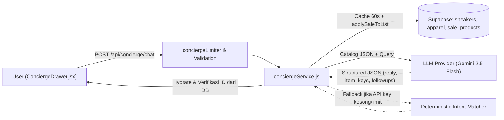

# AI Sneaker Concierge — Spesifikasi & Rencana Implementasi

Dokumen ini merancang fitur **AI Sneaker Concierge** untuk storefront TrueKicks: sebuah drawer chat berbasis LLM yang terhubung langsung ke katalog produk dan harga sale aktual di Supabase, sehingga pengguna dapat mencari sneakers maupun apparel memakai bahasa natural (Indonesia atau Inggris) dan langsung mendapatkan kartu produk yang dapat diklik.

---

## 1. Tujuan & Nilai Produk

- **Pencarian Bahasa Natural**: Pengguna dapat mengetik kebutuhan nyata seperti *"sepatu running hitam di bawah 2 juta"*, *"hoodie yang lagi diskon"*, atau *"rekomendasi sepatu nyaman buat harian"* tanpa harus menyetel banyak filter manual.
- **Akurasi Harga & Katalog (Zero Hallucination)**: Setiap rekomendasi produk bersumber dari katalog aktual (`sneakers`, `apparel`, `sale_products`) lengkap dengan harga sale tersinkron (`applySaleToList`). Model AI tidak diizinkan mengarang produk, SKU, maupun harga di luar data katalog.
- **Konversi Langsung**: Kartu produk di dalam chat langsung menampilkan gambar studio, kategori, badge diskon (`-XX%`), harga efektif + harga coret, dan menavigasi langsung ke halaman detail (`/product/:type/:id`).
- **Tahan Gangguan (Graceful Fallback)**: Jika `GEMINI_API_KEY` belum dipasang atau kuota API sedang habis, backend otomatis menggunakan mesin pencocokan katalog lokal (intent parser harga, kategori, brand, warna, diskon) agar fitur tetap berfungsi tanpa error `500`.

---

## 2. Arsitektur Sistem



### Prinsip Grounding Katalog
1. Backend memuat daftar terdeduplikasi dari `sneakers`, `apparel`, dan `sale_products` lalu menyinkronkan harga sale dengan fungsi `applySaleToList` yang sudah ada di [backend/index.js](../backend/index.js).
2. Snapshot katalog di-cache di memori server selama **60 detik** untuk menjaga latensi rendah dan mengurangi query berulang ke Supabase.
3. Setiap item diberi kunci unik `key` berformat `<productType>:<id>` (contoh: `sneakers:12`, `apparel:4`, `sale_products:2`).
4. LLM menerima daftar ringkas katalog (`key`, `name`, `brand`, `category`, `sub_category`, `price`, `effective_price`, `discount_percentage`) dan diminta mengembalikan output JSON terstruktur berisi `reply`, `recommended_keys` (maksimal 4 item), dan `followups` (maksimal 3 saran pertanyaan lanjutan).
5. Backend melakukan **hydrating ulang** setiap `key` dari snapshot katalog otoritatif. Jika model menyebut `key` yang tidak valid, item tersebut dibuang otomatis sehingga pengguna tidak pernah menerima tautan rusak atau harga palsu.

---

## 3. Kontrak API

### Endpoint
`POST /api/concierge/chat`

- **Auth**: Publik (dapat dipakai guest maupun user login agar langsung membantu konversi sejak kunjungan pertama).
- **Rate Limit**: `conciergeLimiter` khusus di [backend/middleware/rateLimit.js](../backend/middleware/rateLimit.js) (maksimal **15 request / menit / IP**).

### Request Body
```json
{
  "message": "cari sepatu running hitam di bawah 2 juta",
  "history": [
    { "role": "user", "content": "halo" },
    { "role": "assistant", "content": "Halo! Cari sneakers atau apparel apa hari ini?" }
  ],
  "context": {
    "currentPath": "/sneakers"
  }
}
```

### Validasi Input (`express-validator`)
- `message`: wajib, string non-kosong, panjang `1–500` karakter.
- `history`: opsional, array maksimal `8` pesan terakhir; tiap item wajib memiliki `role` (`"user"` | `"assistant"`) dan `content` string maksimal `600` karakter.
- `context.currentPath`: opsional, string maksimal `120` karakter.

### Response `200 OK`
```json
{
  "reply": "Ini beberapa pilihan sneakers running warna gelap di bawah Rp 2.000.000 yang sedang tersedia, termasuk item dengan harga promo.",
  "products": [
    {
      "id": 1,
      "productType": "sneakers",
      "name": "Adidas Adizero Evo SL Black White",
      "category": "Running",
      "price": 2500000,
      "discount_price": 1790000,
      "effective_price": 1790000,
      "discount_percentage": 28,
      "image_url": "https://..."
    }
  ],
  "followups": [
    "Lihat semua sepatu diskon",
    "Bandingkan dengan New Balance",
    "Panduan ukuran EU"
  ],
  "mode": "llm"
}
```

### Error Responses
- `400 Bad Request`: Pesan kosong, terlalu panjang, atau format `history` tidak valid.
- `429 Too Many Requests`: Melebihi batas `conciergeLimiter`.
- `500 Internal Server Error`: Gagal memuat katalog dari Supabase (jika hanya LLM yang gagal, endpoint tetap mengembalikan `200 OK` dengan `mode: "fallback"`).

---

## 4. Konfigurasi Provider LLM & Fallback

### Provider Utama: Google Gemini (`gemini-flash-lite-latest`)
- Menggunakan native `fetch` ke Gemini REST API (`generateContent` dengan `responseMimeType: "application/json"`) sehingga tidak menambah dependensi berat di serverless Vercel dan tetap cepat saat cold start.
- Variabel lingkungan di `backend/.env` dan Vercel Backend (`truekicks-t2dw`):
  ```env
  GEMINI_API_KEY=AIza...
  GEMINI_MODEL=gemini-flash-lite-latest
  ```
- Timeout request ke provider dibatasi **12 detik** (`AbortController`).

### Fallback Deterministik (`mode: "fallback"`)
Apabila `GEMINI_API_KEY` belum diisi, timeout, atau kuota provider tercapai:
1. Parser intent ringan mengekstrak:
   - **Batas harga**: frasa seperti `"di bawah 2 juta"`, `"< 1.5jt"`, `"max 1500k"`, `"murah"`.
   - **Tipe/kategori**: `running`, `basketball`, `lifestyle`, `hoodie`, `jacket`, `pants`, `jersey`, `apparel`, `sneakers`.
   - **Brand**: `nike`, `adidas`, `new balance`, `nb`, `puma`, `converse`, `vans`, `salomon`, `asics`, `jordan`, `fear of god`.
   - **Promo**: kata kunci `diskon`, `sale`, `promo`, `murah`.
   - **Warna/keyword**: `hitam`/`black`, `putih`/`white`, `silver`, `grey`, dan pencocokan token nama produk.
2. Katalog diurutkan berdasarkan skor kecocokan tertinggi (dan diskon terbesar jika menanyakan promo), lalu mengembalikan maksimal 4 kartu produk beserta ringkasan jawaban alami.

---

## 5. Keamanan & Guardrails

- **Anti Prompt Injection**: Katalog disisipkan sebagai blok data JSON murni dengan instruksi sistem eksplisit bahwa pesan user tidak dapat mengubah peran, aturan harga, maupun mengungkap konfigurasi server.
- **Zero PII Exposure**: Backend tidak pernah mengirim data akun (`email`, `phone`, `address`, `orders`) ke LLM.
- **Strict Output Sanitization**: Frontend merender `reply` sebagai plain text (tanpa `dangerouslySetInnerHTML`) dan hanya merender kartu produk hasil validasi ID backend.
- **Proteksi Biaya & Abuse**: Kombinasi `conciergeLimiter` (15 req/menit/IP), batas `message` 500 karakter, batas `history` 8 giliran, dan `maxOutputTokens` terukur.

---

## 6. Desain UI/UX Editorial Minimalis (`ConciergeDrawer.jsx`)

Selaras dengan sistem desain TrueKicks pasca Fase 1–3 (monokrom editorial, `darkMode: 'class'`, tanpa gradien neon/AI-slop):

- **Trigger Button**:
  - Desktop: tombol pill minimalis di sudut kanan bawah (`bg-gray-950 dark:bg-white text-white dark:text-gray-950`, ikon sparkles/chat SVG halus, label `Concierge`).
  - Mobile: ditempatkan di sudut kiri bawah sejajar dengan floating cart (`bottom-24 left-5`) agar tidak menabrak floating Cart maupun `BottomNav`, dan disembunyikan otomatis di `/checkout` serta `/product/...` (atau hanya tampil sebagai tombol ringkas yang tidak mengganggu sticky CTA).
- **Drawer Panel**:
  - Dirender melalui `createPortal(..., document.body)` dengan `z-[9998]` dan `data-lenis-prevent` agar bebas dari stacking context dan scroll tidak bentrok dengan Lenis.
  - Animasi slide-in halus (`motion/react` `AnimatePresence`), menutup lewat klik backdrop atau tombol `Escape`.
  - Lebar `max-w-md` di desktop (slide dari kanan) dan sheet penuh bersih di mobile.
- **Starter Prompts (Empty State)**:
  - 4 chip siap klik:
    1. *"Sneakers running di bawah 2 juta"*
    2. *"Produk yang sedang diskon sekarang"*
    3. *"Rekomendasi sneakers hitam stealth"*
    4. *"Cari hoodie atau apparel"*
- **Kartu Produk Inline dalam Chat**:
  - Frame gambar studio `bg-gray-50 dark:bg-gray-100` dengan `mix-blend-multiply` agar sepatu gelap tetap tajam di dark mode.
  - Menampilkan nama produk, kategori, badge `-XX%` jika diskon, serta harga efektif & harga coret memakai `formatRupiahShort` dari [pricing.js](../frontend/src/lib/pricing.js).
  - Klik kartu langsung menavigasi ke `/product/:productType/:id` dan menutup drawer.
- **Follow-up Chips & Reset**:
  - Tombol `New Chat` di header drawer untuk mereset percakapan.
  - Chip saran lanjutan di bawah balasan terakhir agar eksplorasi katalog cukup 1 tap.

---

## 7. Daftar File & Rencana Implementasi

| Layer | File | Perubahan |
|---|---|---|
| Backend Service | `backend/services/conciergeService.js` *(baru)* | Cache katalog 60s + sale sync, integrasi Gemini REST API, JSON parser + strict DB hydration, dan fallback intent matcher. |
| Backend Middleware | `backend/middleware/rateLimit.js` | Tambah `conciergeLimiter` (15 req / menit / IP). |
| Backend Validation | `backend/middleware/validation.js` | Tambah `conciergeValidation` (`message`, `history`, `context`). |
| Backend Route | `backend/index.js` | Tambah endpoint `POST /api/concierge/chat`. |
| Backend Config | `backend/.env.example` | Dokumentasikan `GEMINI_API_KEY` dan `GEMINI_MODEL`. |
| Frontend UI | `frontend/src/components/ConciergeDrawer.jsx` *(baru)* | Floating trigger + slide-over portal drawer + starter chips + inline product cards + follow-ups. |
| Frontend Layout | `frontend/src/components/Layout.jsx` | Mount `<ConciergeDrawer />` secara global pada rute storefront utama. |
| API Testing | `postman/collections/truekicks-api/` | Tambah request pengujian validasi `400`, query natural language `200`, dan verifikasi grounding produk aktual. |

---

## 8. Kriteria Penerimaan (Acceptance Criteria)

1. Query *"sepatu running hitam di bawah 2 juta"* mengembalikan `200 OK` dengan `products` yang seluruhnya benar-benar ada di Supabase dan memiliki `effective_price <= 2000000`.
2. Produk yang sedang sale di tabel `sale_products` muncul di kartu chat dengan `discount_price` dan persentase diskon yang sinkron dengan halaman `Sale` & `ProductDetail`.
3. Input kosong atau `message > 500` karakter ditolak dengan `400 Bad Request`.
4. Ketika `GEMINI_API_KEY` kosong atau provider gagal, endpoint tetap mengembalikan rekomendasi akurat lewat `mode: "fallback"` tanpa error `500`.
5. Drawer tidak tertimpa elemen sticky/navbar (`createPortal` + `z-[9998]`), mendukung dark mode, menutup via `Escape`, dan scroll chat bekerja normal berdampingan dengan Lenis.
6. Seluruh file lulus ESLint (`0` error baru), Vite production build, dan koleksi Postman CLI (`postman collection lint` + `postman collection run`).
